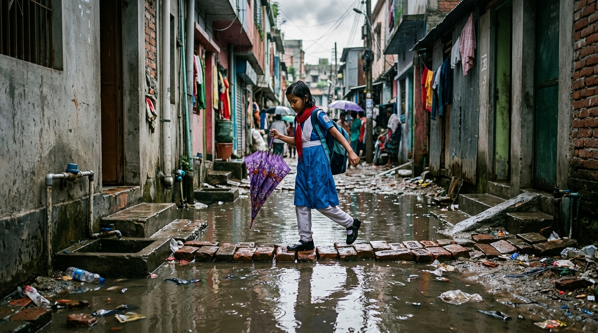

# The Fever That Keeps Coming Back

*The virus is moving faster than the labs tracking it.*

**By Md. Nehal Hasnain**  
*Founder, Bangladesh Open Research Academy (BORA) and Bangladesh Open Research Repository (BORR)* | Find him at: [nehal.has9@gmail.com](mailto:nehal.has9@gmail.com)

---

Mrinmoyee Hridita is 11 and just came home after her third dengue infection in two years. Her father, Mizanur Rahman of Purba Jurain, told The Daily Star last November she has had dengue six times since 2018. All five in the family have had dengue or chikungunya more than once. Their school helps explain why. The ground floor of Purbo Jurain Government Primary School has been waterlogged for nearly 20 years, small pits for water meters breed Aedes larvae in almost every house, and children are still bitten at noon inside classrooms despite spraying.

That story is no longer unusual and not just a Dhaka story. On June 11, The Daily Star reported 276 of 288 hospitalisations in a single day were from outside Dhaka, with more than 75 percent of the year's cases from outside the capital and Barguna alone logging 1,406. Stored water, poor drainage and the Padma Bridge have helped the mosquito travel. Bangladesh recorded 321,197 cases and 1,705 deaths in 2023, over 100,000 cases in both 2024 and 2025, and 546 admissions in a single day this July. August added 20,536 more, the third worst August since 2000.

The wards record cases but they do not show what the virus was doing between outbreaks. To see that, we analysed every dengue and chikungunya genome from six South Asian countries between 2015 and 2025, 6,668 sequences in total, and the pattern showed gaps rather than coverage.

Bangladesh went through two complete dengue serotype switches without noticing. In 2017 DENV-2 dominated. By the 2019 outbreak that hospitalised 101,354 people the virus had flipped almost entirely to DENV-3, and it stayed that way until 2023 when it flipped back to DENV-2 Cosmopolitan. That lineage caused the deadliest year on record, and for people with prior DENV-3 immunity it made severe disease more likely. In 2023 we sequenced fewer than three genomes for every 10,000 patients.

Chikungunya received even less attention. The region produced just 660 genomes in decades, about one ninth of dengue, despite over 867,000 reported cases. Bangladesh sequenced well during the 2017 Dhaka outbreak then went silent for five years while patients lived with joint pain for months.

Our virus family trees found at least 39 separate introductions into Bangladesh, 23 for dengue and 16 for chikungunya. India and Sri Lanka were the most frequent dengue sources and India and Myanmar seeded chikungunya in 2017. Mosquitoes do not queue at immigration. We keep missing these moves because the data needed to catch them is thin. Only 14.6 percent of Bangladeshi sequences carried a district name and in Nepal it was 3.4 percent. Most sequencing happens in a handful of capital labs and collapses when cases surge. As entomologist Prof. Kabirul Bashar warned in these pages, we treat dengue as a Dhaka problem while pits in Barguna and waterlogged schools in Jurain go unmonitored.

What to do is clear. Check houses before the monsoon, clear containers, use Bti in stored water and fix waste management. And add one more line. Sequence at least one genome per 1,000 cases, keep district names, and watch corridors, not just capitals. Mrinmoyee is back at school and her father still checks the pits for larvae. He should not have to do that alone.

---
*Draws on The Daily Star reporting from June 2025 to September 2026 and a decade long analysis of 6,668 dengue and chikungunya genomes from 2015 to 2025. Case figures from DGHS.*
